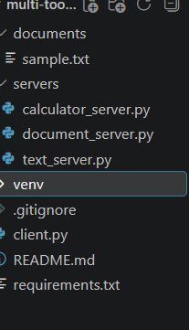
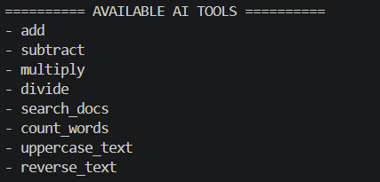
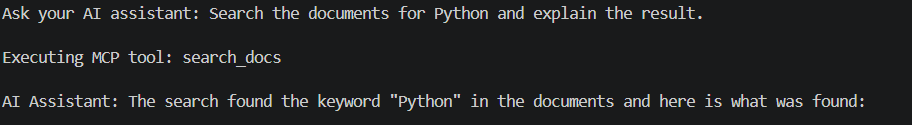
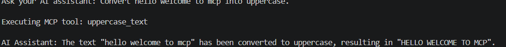
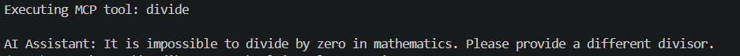

# Multi-Tool AI Assistant Using MCP with Python

## 1. Introduction

This project demonstrates the development of a Multi-Tool AI Assistant using the Model Context Protocol (MCP) and Python.

The assistant connects multiple MCP servers and discovers and executes different tools through a single MCP client.

It provides calculator operations, document searching, and text processing functionalities.

## 2. Project Objectives

- Understand the Model Context Protocol (MCP).
- Create multiple MCP servers using Python.
- Develop a single client to connect to multiple servers.
- Discover available tools dynamically.
- Execute tools through the MCP client.
- Handle errors during tool execution.
- Demonstrate communication between MCP clients and servers.

## 3. Technologies Used

- Python
- Model Context Protocol (MCP)
- FastMCP
- AsyncIO
- VS Code
- Git and GitHub

## 4. Project Architecture

The project contains three MCP servers connected to one MCP client.

### Architecture Diagram

```text
             MCP CLIENT
                  |
       -----------------------
       |          |          |
       v          v          v
  Calculator  Document    Text
   Server     Server    Processing
       |          |          |
       v          v          v
    add()     search_docs() count_words()
    subtract()             uppercase_text()
    multiply()              reverse_text()
    divide()
```

## 5. Project Structure

```text
multi-tool-mcp-assistant/
│
├── servers/
│   ├── calculator_server.py
│   ├── document_server.py
│   └── text_server.py
│
├── documents/
│   └── sample.txt
│
├── screenshots/
│
├── client.py
├── requirements.txt
├── README.md
└── .gitignore
```

## 6. MCP Servers and Available Tools

### A. Calculator Server

Provides mathematical operations.

- add: Adds two numbers.
- subtract: Subtracts two numbers.
- multiply: Multiplies two numbers.
- divide: Divides two numbers.

### B. Document Search Server

Provides document searching functionality.

- search_docs: Searches for a keyword in the sample document and returns matching lines.

### C. Text Processing Server

Provides text processing operations.

- count_words: Counts the words in a given text.
- uppercase_text: Converts text into uppercase.
- reverse_text: Reverses the given text.

## 7. Installation and Setup

### Step 1: Clone the Repository

```bash
git clone YOUR_GITHUB_REPOSITORY_URL
```

### Step 2: Open the Project Folder

```bash
cd multi-tool-mcp-assistant
```

### Step 3: Create a Virtual Environment

```bash
python -m venv venv
```

### Step 4: Activate the Virtual Environment

For Windows PowerShell:

```powershell
.\venv\Scripts\Activate.ps1
```

### Step 5: Install Dependencies

```bash
pip install -r requirements.txt
```

## 8. How to Run the Project

Run the MCP client using:

```bash
python client.py
```

The client connects to all three MCP servers.

It discovers the available tools and allows the user to interact with the assistant.

## 9. Tool Discovery

The MCP client automatically discovers the available tools from all connected servers.

The project provides eight tools:

1. add
2. subtract
3. multiply
4. divide
5. search_docs
6. count_words
7. uppercase_text
8. reverse_text

## 10. Error Handling

The project includes error handling for invalid tool inputs.

Examples:

- Division by zero.
- Empty document search keywords.
- Missing sample document.

These errors are handled by the respective MCP servers and returned to the client.

## 11. Screenshots

Project screenshots are available in the `screenshots` folder.

### Project Structure



### Available MCP Tools



### Calculator Operations


### Document Search



### Text Processing



### Error Handling



## 12. Advantages

- Multiple tools can be connected through a single client.
- Tools are discovered dynamically.
- Each server has separate responsibilities.
- The project is modular and easy to extend.
- Error handling improves reliability.

## 13. Learning Outcomes

Through this project, I learned:

- The fundamentals of Model Context Protocol.
- How to create MCP servers using FastMCP.
- How to connect multiple MCP servers using one client.
- How to discover and execute tools.
- How to handle errors in MCP applications.
- How to manage and publish projects using GitHub.

## 14. Conclusion

This project demonstrates how the Model Context Protocol connects an AI application with multiple external tools and services.

By developing three MCP servers and one MCP client, the project successfully demonstrates calculator operations, document searching, text processing, tool discovery, and error handling.

The project provides a foundation for building more advanced AI assistants with additional tools and capabilities.

## 15. References

- MCP Documentation: https://modelcontextprotocol.io/
- Python Documentation: https://www.python.org/doc/
- MCP Python SDK: https://github.com/modelcontextprotocol/python-sdk
- GitHub: https://github.com/
